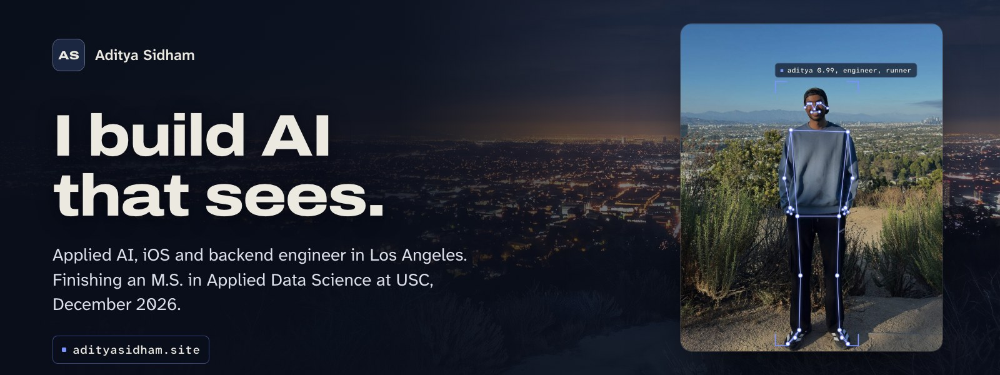
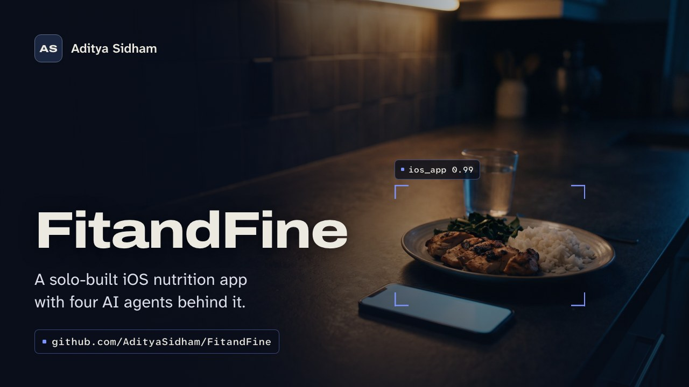
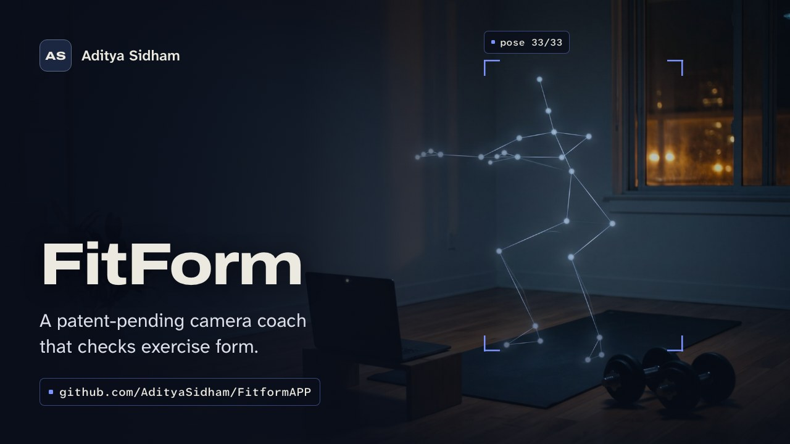
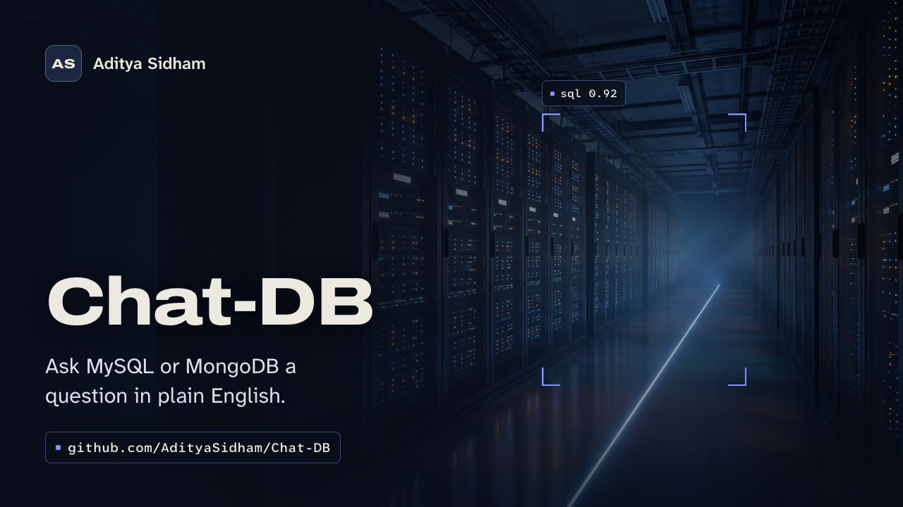
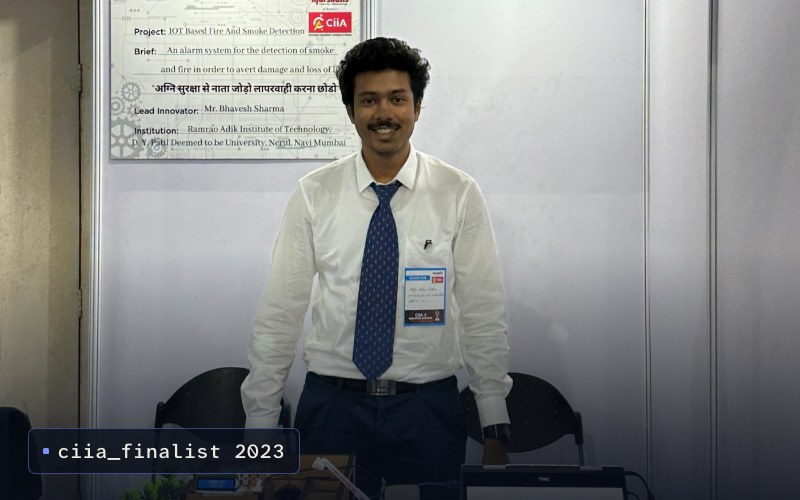
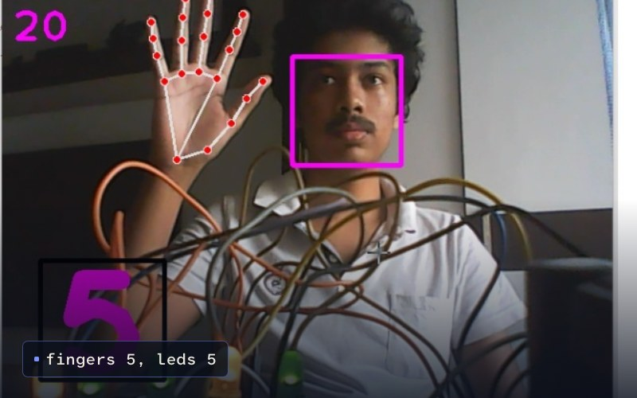
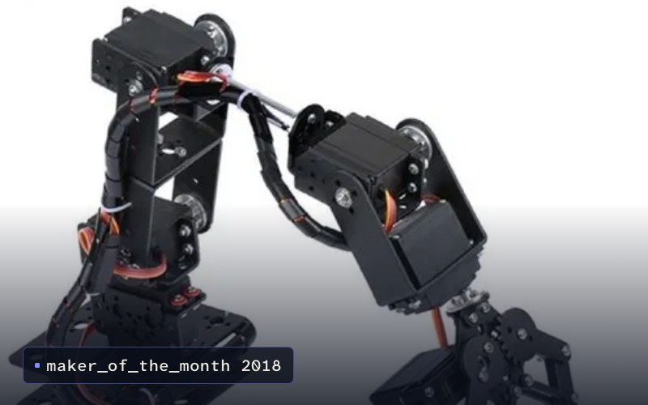

  
  
  
  
  

### Hi, I'm Aditya.

I build complete systems around models that look at the real world: the camera or the label photo, the backend that turns it into data, and the app a person actually uses. Then I stay past the demo and fix what breaks when real people use it.

I'm finishing an M.S. in Applied Data Science at USC (December 2026), after a B.Tech in Computer Engineering from DY Patil RAIT and enterprise backend work at LTIMindtree and TCS. I'm looking for **full-time roles in AI, iOS and backend engineering**, and for early-stage teams that need someone to own a problem end to end.

- **Building** [FitandFine](https://github.com/AdityaSidham/FitandFine), a solo iOS nutrition platform: SwiftUI app, FastAPI backend, four AI agents.
- **Published** Indian patent application 202421099595 for [FitForm](https://github.com/AdityaSidham/FitformAPP), as a co-applicant.
- **Off screen** strength training, calisthenics and distance running, most recently a 30K long run.

## Selected work

<table>
<tr>
<td width="50%" valign="top">

<h3><a href="https://github.com/AdityaSidham/FitandFine">FitandFine</a></h3>
Nutrition tracking that adapts to the person using it. Barcode and label scanning, Apple Health data, and four Gemini agents that read labels, review your week, suggest meals and propose calorie changes you approve. I built all of it.
  
<b>&lt;500 ms</b> barcode to food card, <b>50,000+</b> USDA foods, <b>85%+</b> label-field accuracy
  
SwiftUI, SwiftData, HealthKit, FastAPI, PostgreSQL, Redis, Celery, Gemini API, AWS
</td>
<td width="50%" valign="top">

<h3><a href="https://github.com/AdityaSidham/FitformAPP">FitForm</a></h3>
A webcam coach that tracks 33 body landmarks, turns them into joint angles, and counts a rep only when it completes the full range. It led to a published patent application.
  
<b>25 FPS</b> on a laptop CPU, <b>30% fewer</b> false reps across 120 annotated clips
  
Python, MediaPipe, OpenCV, Streamlit
</td>
</tr>
<tr>
<td width="50%" valign="top">

<h3><a href="https://github.com/AdityaSidham/Chat-DB">Chat-DB</a></h3>
Ask MySQL or MongoDB a question in plain English. It reads the live schema, writes the SQL or aggregation pipeline, shows it and runs it. I led the four-person USC team.
  
<b>~60%</b> less query-writing time, <b>92%</b> correct on 150 labeled questions
  
Python, Streamlit, Gemini API, MySQL, MongoDB
</td>
<td width="50%" valign="top">

<h3><a href="https://github.com/AdityaSidham/Adi_Portfolio">adityasidham.site</a></h3>
My portfolio. Scrolling pushes a canvas camera through six nested Runway stills, locking onto each target before it moves. Plain HTML, CSS and JavaScript.
  
<b>0</b> runtime dependencies, <b>34 KB</b> of code gzipped, captions at <b>4.2:1+</b> contrast
  
HTML, CSS, JavaScript, Canvas, Runway
</td>
</tr>
</table>

## Where I've worked

| | Role | What I did |
|---|---|---|
| **LTIMindtree** (now LTM) Mumbai, Sep to Dec 2024 | Software Engineer | Built C# / ASP.NET and REST integrations for Otis's enterprise application, connecting service management, dispatch, inventory and reporting. Rebuilt the SQL Server fault-event ingestion behind work orders and cut backend issue-resolution time by **20%**. |
| **Tata Consultancy Services** Navi Mumbai, Jan to May 2024 | Software Development Intern | Built a Java / Spring Boot module for the Central Plan Scheme Monitoring project. SQL automation and form validation cut manual data entry by **35%**, shipped in two-week sprints. |
| **Aces Invensys Technologies** Navi Mumbai, May to Jun 2023 | IoT Intern | Built a Python / MQTT pipeline that turned live beacon signals into positions, accurate to about **±10 cm** in testing. |

| School | Degree | |
|---|---|---|
| **University of Southern California** Los Angeles, 2025 to Dec 2026 | M.S. Applied Data Science | GPA 3.52. Natural language processing, machine learning for data science, data mining. |
| **DY Patil Ramrao Adik Institute of Technology** Navi Mumbai, 2020 to 2024 | B.Tech Computer Engineering, Data Science specialization | GPA 3.68. Computer vision, IoT and robotics projects. |

## Toolbox

<table>
<tr><td><b>AI and vision</b></td><td>         </td></tr>
<tr><td><b>Languages</b></td><td>        </td></tr>
<tr><td><b>Apps</b></td><td>    </td></tr>
<tr><td><b>Backend</b></td><td>     </td></tr>
<tr><td><b>Data</b></td><td>       </td></tr>
<tr><td><b>Cloud and DevOps</b></td><td>    </td></tr>
<tr><td><b>Hardware</b></td><td>   </td></tr>
</table>

## Landmarks

| When | |
|---|---|
| Jan 2025 | **Patent application published.** Co-applicant on Indian patent application 202421099595, *AI Powered Exercise Tracking and Form Correction System*, for FitForm. |
| Jun 2024 | **Google Data Analytics Professional Certificate.** Data preparation, analysis and visualization, on Coursera. |
| 2023 | **CIIA finalist.** Led the four-person SafeSense team to the Creative Ideas & Innovations in Action finals. |
| Jun 2023 | **Harvard Business School Online.** Business Analytics and Sustainable Business Strategy. |
| Sep 2018 | **SP Robotics Maker of the Month** for a servo robotic arm I built and programmed. |

## Where it started

Before the software got serious, I was debugging with a multimeter as often as a terminal.

<table>
<tr>
<td width="33%" valign="top"> <b><a href="https://adityasidham.site/FireandSmokeDetectionPage.html">SafeSense</a></b>, 2023 An ESP8266 fire and smoke alarm that reaches you over GSM and Wi-Fi when nobody is home.</td>
<td width="33%" valign="top"> <b><a href="https://adityasidham.site/FaceandHanddetection.html">Face &amp; Hand Recognition</a></b>, 2021 Count raised fingers on camera and light the same number of LEDs through an Arduino.</td>
<td width="33%" valign="top"> <b><a href="https://adityasidham.site/RoboticArm.html">Gesture-Controlled Robotic Arm</a></b>, 2018 A servo arm, later extended to mirror your hand through a gyroscope.</td>
</tr>
</table>

---

  <b>Have a hard problem? I'd like to hear it.</b>
   
  <a href="mailto:sidham@usc.edu">sidham@usc.edu</a> &nbsp;|&nbsp; <a href="https://www.linkedin.com/in/adityasidham/">LinkedIn</a> &nbsp;|&nbsp; <a href="https://adityasidham.site">adityasidham.site</a>
    
  Los Angeles, from Mumbai. Scene stills made with Runway. Photos and screenshots are real.

